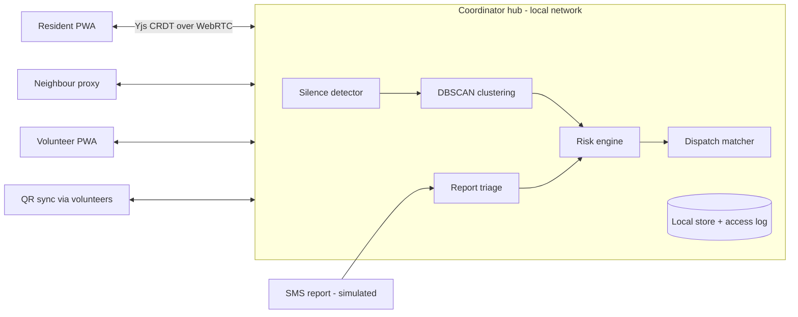

# RahatLink

> Other apps wait for an SOS. **RahatLink notices who went silent.**

Team **CodeForge** | SRIJAN 2K26 | Open Innovation | SRMCEM, Lucknow

RahatLink is an offline-first neighbourhood safety app. Residents tap a daily "I'm okay" check-in. When check-ins stop, RahatLink raises a graded alert, clusters nearby silent households, ranks them with a transparent risk score, and lets a coordinator approve a volunteer dispatch. A consented health profile reaches the volunteer only after they accept the task.

All demo data is **simulated**. SMS is simulated through the hub. Bluetooth mesh is on the roadmap, not built.

## Documents
| File | Purpose |
|---|---|
| `docs/PRD.md` | What we build and why: users, features, scope, success measures |
| `docs/TRD.md` | How we build it: architecture, data model, algorithms, APIs |
| `docs/TASKS.md` | Ordered build checklist with acceptance checks |
| `docs/THEME.md` | Visual design system: colours, type, components |
| `docs/WORKFLOW.md` | How the team and the AI tool work together |
| `AGENTS.md` | Short context file for AI coding tools (read this first) |
| `RahatLink_build_prompts.md` | Copy-paste prompts, one per task |

## Quick start
```bash
npm install

# Start both web and hub concurrently (web on :5173, hub on :4444)
npm run dev

# Or start individually:
npm run dev:web    # React PWA on http://localhost:5173
npm run dev:hub    # Node.js Hub on http://localhost:4444

# Run test suite
npm test           # Vitest unit test suite in packages/core

# Production builds
npm run build      # Builds @rahatlink/core, apps/web, and apps/hub
```
Phones and laptop must be on the same hotspot or campus Wi-Fi. No internet is needed after first load.

## Repo layout
```
apps/web        React PWA (residents, neighbours, volunteers, coordinator)
apps/hub        Node.js hub: signaling, headless detection engine, SMS endpoint, briefing unlock
packages/core   Types, silence engine, DBSCAN, risk score, matcher, SMS parser
scripts         Simulator and measurement
docs            PRD, TRD, TASKS, THEME, WORKFLOW
```

## Architecture


## Honesty notes
- Numbers shown from the simulator are computed from a scripted scenario and labelled simulated.
- The risk score is a transparent weighted formula approved by a human, not a trained model.
- Health data is self-reported, stays on the local hub, and is never medical advice.

## Team
CodeForge: add member names here.
