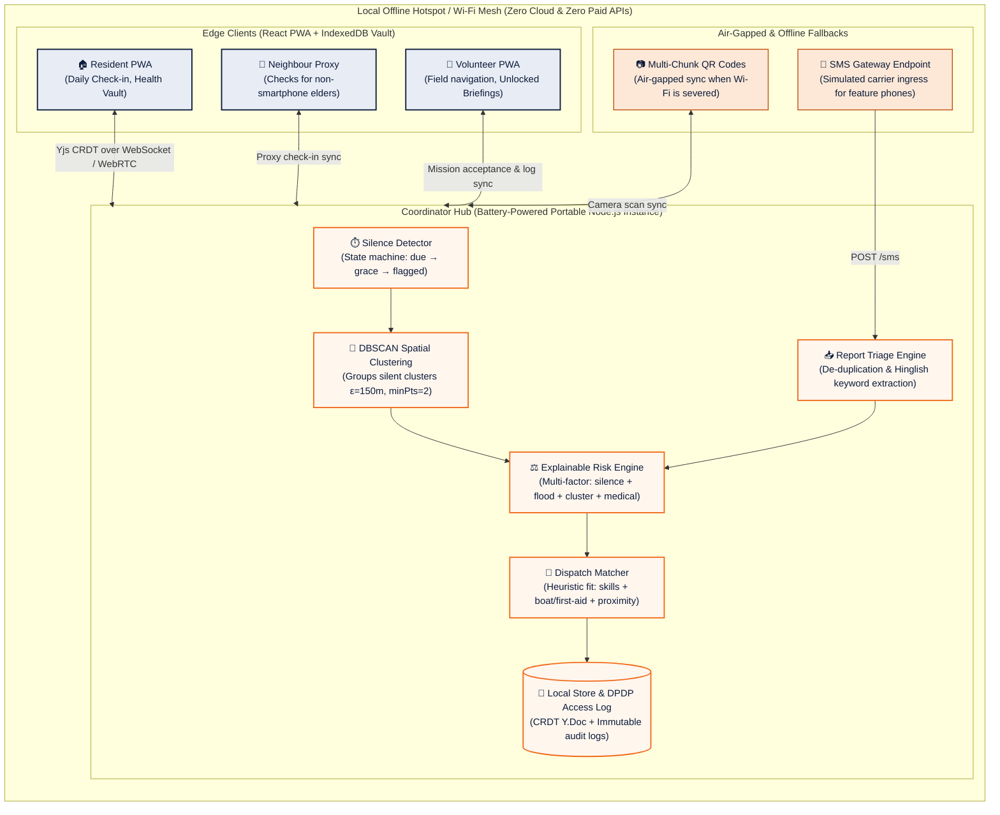

# RahatLink

> Other apps wait for an SOS. **RahatLink notices who went silent.**

Team **CodeForge** | SRIJAN 2K26 | Open Innovation | SRMCEM, Lucknow

RahatLink is an offline-first neighbourhood safety web application. Residents tap a daily "I'm okay" check-in. When check-ins stop, RahatLink raises a graded alert, clusters nearby silent households, ranks them with an explainable multi-factor risk score, and lets a coordinator approve volunteer dispatch. In compliance with India's DPDP Act, sensitive health records reach a volunteer only after they accept the mission, and access expires upon resolution.

All demo data is **simulated**. SMS is simulated through the hub. Bluetooth mesh is on the roadmap, not built.

---

## ⚡ 5-Minute Setup for New Teammates

A teammate who has never seen the repository can run the entire live demo in under 5 minutes:

```bash
# 1. Clone & install dependencies
git clone https://github.com/ShreyashWeb/RahatLink.git
cd RahatLink
npm install

# 2. Run unit tests to verify local environment (84 tests, 89.4% coverage)
npm test

# 3. Start the Offline Hub and Web App in parallel
# Terminal 1: Local Hub (port 4444)
npm run hub

# Terminal 2: Vite Web Client (port 5173)
npm run dev

# 4. (Demo day) Seed the realistic Riverside flood scenario in 60x fast mode
npm run sim:fast
```

Open your browser to:
- **Coordinator Command Center**: [http://localhost:5173/](http://localhost:5173/)
- **Resident Portal**: [http://localhost:5173/resident](http://localhost:5173/resident)
- **Volunteer Field App**: [http://localhost:5173/volunteer](http://localhost:5173/volunteer)

To run the automated end-to-end verification script:
```bash
npm run test:e2e       # Automated Playwright run through all 8 demo milestones
```

---

## 🗺️ One-Page Architecture Diagram



---

## 📚 Key Presentation & Documentation Files

| File | Description |
|---|---|
| [`DEMO.md`](./DEMO.md) | **3-Minute Demo Script**: Exact click paths, timings (0:00 to 2:45), speaking cues, and the big close. |
| [`JUDGES_QA.md`](./JUDGES_QA.md) | **Judges' Q&A Cheat Sheet**: Direct answers on DPDP privacy, false alarm reduction, adoption, why not telecom data, real vs simulated. |
| [`docs/PRD.md`](./docs/PRD.md) | Product Requirements Document: Problem statement, users, non-functional requirements. |
| [`docs/TRD.md`](./docs/TRD.md) | Technical Requirements Document: Data schemas, CRDT structure, mathematical models. |
| [`docs/THEME.md`](./docs/THEME.md) | Design system: Emergency Navy (`#0B1B3A`) + Action Orange (`#F26A1B`) palette. |
| [`docs/TASKS.md`](./docs/TASKS.md) | 14 engineering prompts & milestone verification records. |

---

## 🧪 Test Coverage (`packages/core`)

The pure logic engine in `packages/core` is rigorously unit tested:

| Metric | Packages / Core Result | Target |
| :--- | :--- | :--- |
| **Statements** | **89.36%** | > 85% |
| **Branches** | **84.01%** | > 80% |
| **Functions** | **87.09%** | > 85% |
| **Lines** | **89.36%** | > 85% |
| **Test Suites** | **9 passed, 84 tests total** | 100% pass |

Edge-case coverage includes:
- **Silence Ladder**: Boundary transitions (`due` $\to$ `grace` $\to$ `reminded` $\to$ `pinged` $\to$ `flagged`), disaster mode multiplier (0.5x), custom grace periods.
- **DBSCAN Clustering**: Zero points, single outlier point, duplicate overlapping coordinates, all noise, tight multi-point clusters.
- **Risk Score Tiers**: Normalization (0-100), factor bounds, suppressed medical points when consent is false, flood zone elevation.
- **DPDP Access Matrix**: Unaccepted task hides health data; acceptance grants time-bounded view; resolution expires access token.
- **Hinglish SMS Parser**: Keyword and urgent token extraction, coordinate parsing, duplicate report thresholding.
- **QR Chunking**: Air-gapped payload splitting, CRC checksum validation, multi-frame reassembly.

---

## 📊 What This Simulation Does and Does Not Prove

The benchmark in `scripts/simulate.ts` executes the deterministic **"Riverside Flood"** scenario (40 households, 2 flood zones, 8 volunteers, 6 health profiles, 60 field reports) with a fixed pseudo-random seed (`seed=42`).

To reproduce the benchmark:
```bash
npm run sim:measure   # Headless execution, prints metrics and writes results/sim_results.csv
npm run sim:fast      # 60x accelerated live simulation driving the Hub & Coordinator UI
npm run sim           # Real-time interactive simulation
```

### What it proves:
1. **Mathematical correctness of the proactive silence ladder**: Demonstrates that the deterministic escalation operates strictly according to configured cadences without skipped stages.
2. **Deterministic DBSCAN clustering**: Proves that spatial clustering groups physically contiguous silent households ($<150\text{ m}$) into prioritized dispatches while isolating distant noise/outliers into single low-priority tasks.
3. **Transparent multi-factor risk scoring**: Confirms that medical vulnerability (insulin-dependent, oxygen, mobility), flood proximity, and corroborating field reports mathematically elevate the most critical households to the top of the coordinator's dispatch queue.
4. **False alarm clearance via peer verification**: Proves that a single in-person neighbour check (`seenSafe`) successfully resets the ladder clock and clears false alarms without central coordinator overhead.
5. **Human workload reduction**: Demonstrates that proactive silence detection replaces exhaustive phone sweeps ($N=40$ manual inquiries) with focused dispatches targeting confirmed clusters.

### What it does NOT prove:
1. **Not a replacement for real-world disaster telecommunication trials**: Simulated cellular outages and SMS ingress do not test physical radio propagation or physical battery depletion curves under extreme environmental conditions.
2. **Not clinical diagnosis or certified emergency dispatch**: Health profiles and risk weights are self-reported community proxies, not certified emergency medical services (EMS) triage protocols.
3. **Not real GSM/SMS hardware**: The SMS gateway endpoint (`POST /sms`) parses raw text using local rule-based token extraction rather than physical GSM modem AT-commands.
4. **Not a Bluetooth mesh network**: Bluetooth mesh is documented on the architecture roadmap and is not active in this prototype (Hard Rule #5).

---

## ⚖️ Hard Rules & Integrity Notes
- **Simulated Data**: All numbers shown in the simulator are computed from a scripted scenario and explicitly labelled SIMULATED.
- **Human Oversight**: Automated risk scoring only suggests; a human coordinator approves every dispatch.
- **Privacy First**: Medical data is opt-in, stored locally, and masked until a volunteer accepts an approved dispatch.

---

## 👥 Team
**Team CodeForge** | SRIJAN 2K26
