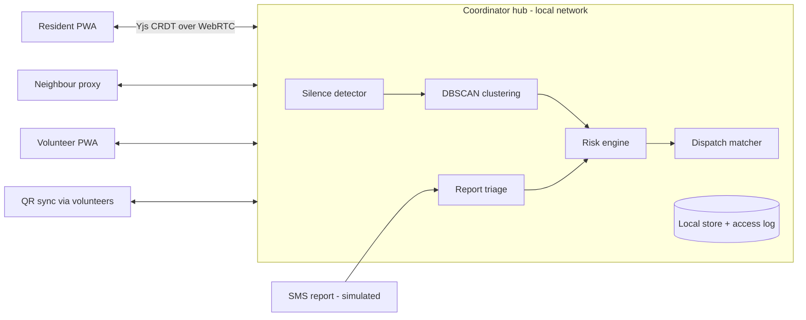

# RahatLink

> Other apps wait for an SOS. **RahatLink notices who went silent.**

Team **CodeForge** | SRIJAN 2K26 | Open Innovation | SRMCEM, Lucknow

RahatLink is an offline-first neighbourhood safety app. Residents tap a daily "I'm okay" check-in. When check-ins stop, RahatLink raises a graded alert, clusters nearby silent households, ranks them with a transparent risk score, and lets a coordinator approve a volunteer dispatch. A consented health profile reaches the volunteer only after they accept the task.

All demo data is **simulated**. SMS is simulated through the hub. Bluetooth mesh is on the roadmap, not built.

## Documents
| File | Purpose |
|---|---|
| `docs/PRD.md` | What we build and why: users, features, scope, success measures |
| `docs/TRD.md` | How we build it: architecture, data model, algorithms, APIs |
| `docs/TASKS.md` | Ordered build checklist with acceptance checks |
| `docs/THEME.md` | Visual design system: colours, type, components |
| `docs/WORKFLOW.md` | How the team and the AI tool work together |
| `AGENTS.md` | Short context file for AI coding tools (read this first) |
| `RahatLink_build_prompts.md` | Copy-paste prompts, one per task |

## Quick start
```bash
npm install

# Start both web and hub concurrently (web on :5173, hub on :4444)
npm run dev

# Or start individually:
npm run dev:web    # React PWA on http://localhost:5173
npm run dev:hub    # Node.js Hub on http://localhost:4444

# Run test suite
npm test           # Vitest unit test suite in packages/core

# Production builds
npm run build      # Builds @rahatlink/core, apps/web, and apps/hub
```
Phones and laptop must be on the same hotspot or campus Wi-Fi. No internet is needed after first load.

## Repo layout
```
apps/web        React PWA (residents, neighbours, volunteers, coordinator)
apps/hub        Node.js hub: signaling, headless detection engine, SMS endpoint, briefing unlock
packages/core   Types, silence engine, DBSCAN, risk score, matcher, SMS parser
scripts         Simulator and measurement
docs            PRD, TRD, TASKS, THEME, WORKFLOW
```

## Architecture


## What this simulation does and does not prove

The benchmark in `scripts/simulate.ts` executes the deterministic **"Riverside Flood"** scenario (40 households, 2 flood zones, 8 volunteers, 6 health profiles, 60 field reports) with a fixed pseudo-random seed (`seed=42`).

To reproduce the benchmark:
```bash
npm run sim:measure   # Headless execution, prints metrics and writes results/sim_results.csv
npm run sim:fast      # 60x accelerated live simulation driving the Hub & Coordinator UI
npm run sim           # Real-time interactive simulation
```

### What it proves:
1. **Mathematical correctness of the proactive silence ladder**: Demonstrates that the deterministic escalation from `due` → `grace` → `reminded` → `pinged` → `flagged` operates strictly according to configured cadences without skipped stages.
2. **Deterministic DBSCAN clustering**: Proves that spatial clustering groups physically contiguous silent households ($<150\text{ m}$) into prioritized dispatches while isolating distant noise/outliers into single low-priority tasks.
3. **Transparent multi-factor risk scoring**: Confirms that medical vulnerability (insulin-dependent, oxygen, mobility), flood proximity, and corroborating field reports mathematically elevate the most critical households to the top of the coordinator's dispatch queue.
4. **False alarm clearance via peer verification**: Proves that a single in-person neighbour check (`seenSafe`) successfully resets the ladder clock and clears false alarms without central coordinator overhead.
5. **Human workload reduction**: Demonstrates that proactive silence detection replaces exhaustive phone sweeps ($N=40$ manual inquiries) with focused dispatches targeting confirmed clusters.

### What it does NOT prove:
1. **Not a replacement for real-world disaster telecommunication trials**: Simulated cellular outages and SMS ingress do not test physical radio propagation, multipath RF reflections, or physical battery depletion curves under extreme environmental conditions.
2. **Not clinical diagnosis or certified emergency dispatch**: Health profiles and risk weights are self-reported community proxies, not certified emergency medical services (EMS) triage protocols.
3. **Not real GSM/SMS hardware**: The SMS gateway endpoint (`POST /sms`) parses raw Hinglish text using local rule-based token extraction rather than physical GSM modem AT-commands.
4. **Not a Bluetooth mesh network**: Bluetooth mesh is documented on the architecture roadmap and is not active in this prototype (Hard Rule #5).

## Honesty notes
- Numbers shown from the simulator are computed from a scripted scenario and labelled simulated.
- The risk score is a transparent weighted formula approved by a human, not a trained model.
- Health data is self-reported, stays on the local hub, and is never medical advice.

## Team
CodeForge: SRIJAN 2K26

